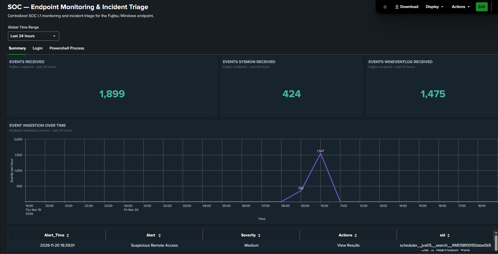

# Summary — Endpoint Monitoring Overview

## 1. Purpose

The Summary tab provides the initial monitoring view of the Windows endpoint. It allows a SOC Analyst L1 to review collected event volume, observe activity trends, and identify security alerts triggered by configured Splunk detections.

The tab consists of three main components:

- Event Volume Overview
- Event Activity Over Time
- Generated Security Alerts

## 2. Event Volume Overview

The upper section contains three Single Value panels that provide an overview of the collected endpoint telemetry.

### 2.1 Total Events

**Description:**

Displays the combined number of events collected from the `sysmon` and `wineventlog` indexes within the selected time range.

**Analyst Use:**

Provides an immediate overview of the total telemetry available for monitoring. It helps establish the volume of collected events during the selected period.

### 2.2 Total Sysmon Events

**Description:**

Displays the number of events collected in the `sysmon` index.

**Analyst Use:**

Provides visibility into the volume of detailed endpoint activity recorded by Sysmon. Changes in this value can help identify variations in endpoint telemetry that may require review.

### 2.3 Total Windows Event Log Events

**Description:**

Displays the number of events collected in the `wineventlog` index.

**Analyst Use:**

Provides visibility into the volume of Windows Event Log data available for security monitoring, including authentication and operating system activity.

**Analyst Considerations:**

The three metrics provide a quick overview of telemetry volume. Changes in event counts should be interpreted in context and do not independently indicate malicious activity or collection problems.

## 3. Event Activity Over Time

**Description:**

Displays the number of collected events grouped into hourly intervals across the selected time range.

**Analyst Use:**

This visualization helps the analyst:

- Identify periods of increased or decreased event activity.
- Observe variations in endpoint telemetry throughout the day.
- Identify time windows that may require closer examination.
- Establish a temporal reference for subsequent investigations.

**Investigation Approach:**

When an unusual increase or decrease is observed, the analyst can investigate the corresponding time window in Splunk.

Relevant questions include:

- Which event sources contributed to the activity?
- Which event types were generated?
- Did the activity coincide with suspicious authentication or process execution?
- Can the observed activity be explained by normal system or user operations?

An unusual event volume is an investigative starting point, not a security verdict.

## 4. Generated Security Alerts

**Description:**

Displays security alerts recorded by Splunk after configured detection searches are triggered.

The table provides a centralized view of alert activity within the selected monitoring period.

### Displayed Fields

| Field | Description |
|---|---|
| Alert Time | Date and time when the alert was triggered. |
| Alert | Name of the triggered detection. |
| Severity | Severity assigned to the alert. |
| Actions | Provides access to the original search results through the View Results action. |

**Analyst Use:**

This panel helps the analyst identify triggered detections, review their severity, and access the underlying search results for further examination.

**Investigation Workflow:**

1. Review the triggered alerts.
2. Prioritize alerts according to their severity and potential impact.
3. Select View Results to access the original search results.
4. Examine the underlying events and identify relevant evidence.
5. Determine whether the activity is benign, suspicious, or requires escalation.

**Important Consideration:**

A triggered alert means that a configured detection condition was met. It does not automatically confirm malicious activity or endpoint compromise. The analyst must validate the underlying evidence and surrounding context before assigning a verdict.

## 5. Analyst Workflow

The Summary tab serves as the starting point for endpoint monitoring.

The recommended sequence is:

1. Review the three event volume metrics.
2. Examine hourly event activity for unusual variations.
3. Review generated security alerts.
4. Open relevant alert results and examine the supporting events.
5. Continue the investigation in the corresponding dashboard section, such as Authentication or Process & Execution.

## 6. Limitations

- Event counts represent collected telemetry, not the number of security incidents.
- Event volume alone cannot determine whether activity is malicious.
- Hourly event distribution provides temporal context but does not identify the cause of activity.
- Alert visibility depends on the configured detection searches and their execution.
- Triggered alerts require manual validation.
- The displayed information is limited to the selected time range and available endpoint telemetry.

## 7. Screenshot

