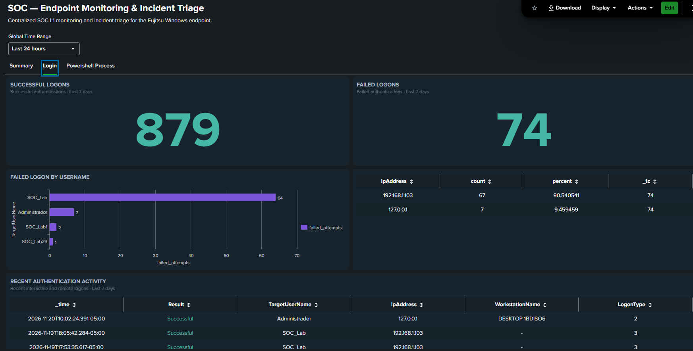

# Authentication — Login Monitoring and Brute-Force Detection

## 1. Purpose

The Authentication tab provides visibility into authentication activity on the monitored Windows endpoint.

It helps the analyst identify unusual login patterns, review failed authentication attempts, identify potentially targeted accounts and correlate source IP addresses to investigate possible brute-force activity.

## 2. Authentication Overview

Two Single Value panels provide a quick overview of authentication activity:

| Panel | Description |
|---|---|
| Successful Logons | Total number of successful authentication events within the selected time range |
| Failed Logons | Total number of failed authentication events within the selected time range |

**Analyst Use:**

These metrics provide an initial overview of authentication activity.

A high number of failed logons may indicate password guessing, brute-force attempts or other authentication problems. Successful logons provide additional context when investigating whether suspicious attempts were followed by a successful authentication.

**Important:** These metrics represent authentication events, not confirmed security incidents.

## 3. Failed Logons by Username

This bar chart displays failed authentication attempts grouped by username.

**Purpose:**

Identify accounts receiving an unusual number of failed login attempts.

**Analyst Use:**

- Identify accounts targeted by repeated authentication failures.
- Compare failed login activity across different usernames.
- Detect potential password-guessing or brute-force patterns.
- Identify whether activity is concentrated on a single account or distributed across multiple accounts.

**Investigation Considerations:**

A high number of failed attempts against one account may indicate targeted password guessing. However, legitimate causes such as incorrect saved credentials, misconfigured services or repeated user errors must also be considered.

## 4. Failed Logons by Source IP

This table lists the IP addresses associated with failed authentication attempts.

**Purpose:**

Provide source-IP context to support the investigation of suspicious authentication activity.

**Analyst Use:**

- Identify the IP addresses generating failed logons.
- Correlate source IP addresses with the usernames targeted in the previous visualization.
- Identify whether multiple accounts are being targeted from the same source.
- Determine whether authentication failures originate from one or multiple systems.

**Investigation Considerations:**

An IP address associated with numerous failed logons may represent a potential attack source. The analyst should correlate the IP address with the targeted accounts, timestamps, successful logons and other available endpoint telemetry.

## 5. Recent Authentication Logons

This table provides a detailed view of recent authentication events recorded on the monitored Windows endpoint.

It allows the analyst to review individual logon events rather than relying exclusively on aggregated statistics.

**Analyst Use:**

- Review recent successful and failed authentication activity.
- Investigate individual authentication events.
- Correlate event timestamps with suspicious login patterns.
- Examine available event details to identify potentially unauthorized access.
- Determine whether failed attempts were followed by a successful logon.

Windows Security Event IDs used in authentication investigations include:

| Event ID | Description |
|---|---|
| 4624 | Successful logon |
| 4625 | Failed logon |

These events provide important evidence when investigating authentication-related alerts.

## 6. Analyst Investigation Workflow

The recommended workflow for using this tab is:

1. Review the Successful Logons and Failed Logons indicators to understand the overall authentication activity.
2. Examine Failed Logons by Username to identify potentially targeted accounts.
3. Review Failed Logons by Source IP to identify the systems generating the authentication failures.
4. Correlate usernames, source IP addresses and timestamps.
5. Examine Recent Authentication Logons to investigate individual events.
6. Determine whether the activity is consistent with normal user behavior, a possible brute-force attempt or another authentication-related issue.
7. If suspicious activity is confirmed, document the evidence and follow the incident escalation procedure.

## 7. Limitations and Considerations

- A high number of failed logons does not automatically confirm a brute-force attack.
- Failed authentication events may result from legitimate user errors or misconfigured services.
- A successful logon following multiple failures requires investigation but does not independently prove account compromise.
- Source IP addresses should be correlated with other available evidence before attributing malicious activity.
- Authentication visibility depends on the collected Windows Security Event Logs and the selected dashboard time range.
- This dashboard supports initial triage; it does not independently establish whether an account has been compromised.

## 8. Screenshot

