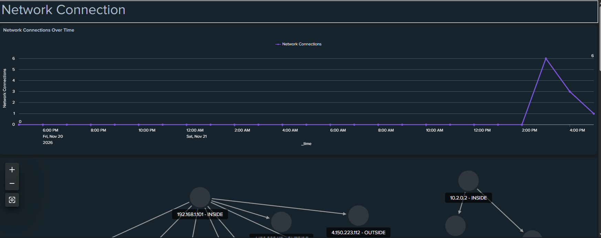
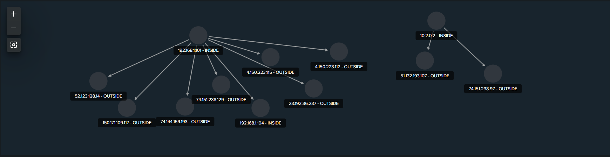
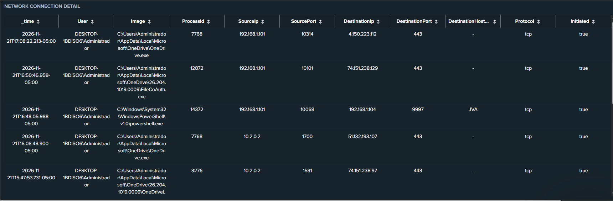
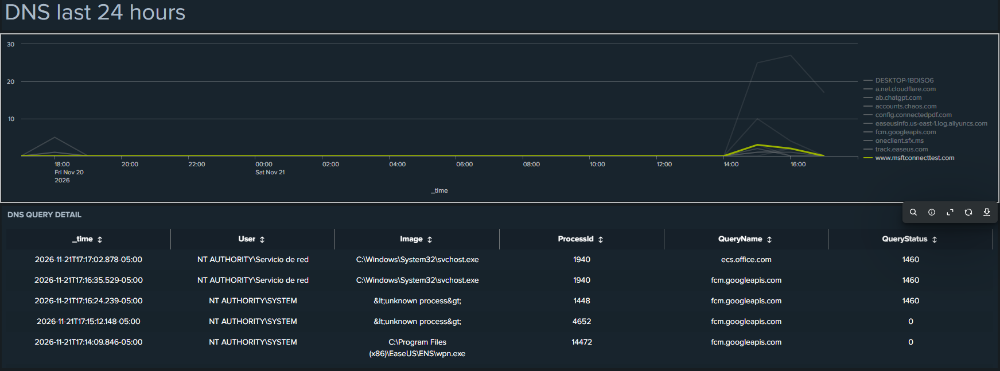

# 04 – Network Monitoring

## 1. Overview

The **Network** tab provides visibility into the network activity of the monitored Fujitsu workstation (`DESKTOP-1BDISO6`).

Its purpose is to help a SOC Analyst L1 monitor network connections, identify communication with internal and external IP addresses, and review DNS queries generated by the endpoint.

The tab combines Sysmon Event ID 3 and Event ID 22 telemetry to provide an overview of network behavior and support further investigation when suspicious activity is identified.

## 2. Dashboard Components

### 2.1. Network Connections Over Time

**Visualization:** Line Chart  
**Data Source:** Sysmon Event ID 3  
**Time Range:** Last 24 hours

Displays the network connections recorded on the Fujitsu workstation over the previous 24 hours.

This visualization helps identify changes in network activity, periods of increased communication, and unusual connection patterns that may require further investigation.

### 2.2. Network Graph

**Visualization:** Network Graph  
**Data Source:** Sysmon Event ID 3

Provides a graphical representation of the network communications recorded on the Fujitsu workstation.

The graph displays source and destination IP addresses and their communication relationships. It classifies IP addresses into two categories:

- **Internal:** IP addresses belonging to private network ranges.
- **External:** IP addresses outside the classified private network ranges.

This visualization helps the analyst understand the workstation's network communication patterns and identify external destinations for further review.

### 2.3. Detailed Network Connections

**Visualization:** Table  
**Data Source:** Sysmon Event ID 3

Displays detailed information about the network connections recorded on the endpoint.

The table includes relevant fields such as:

- Event timestamp.
- Source IP address.
- Destination IP address.
- Source and destination ports.
- Network protocol.
- Process responsible for the connection.
- Connection initiation status (`Initiated`).

This information allows the analyst to investigate individual connections, identify the processes responsible for network activity, and collect evidence for incident documentation.

### 2.4. DNS Queries Over Time

**Visualization:** Line Chart  
**Data Source:** Sysmon Event ID 22  
**Time Range:** Last 24 hours

Displays DNS query activity generated by the Fujitsu workstation over the previous 24 hours.

The visualization helps identify frequently queried domains, changes in DNS activity, and unusual query patterns that may warrant further investigation.

It provides additional context for understanding which domains applications and processes attempt to resolve.

### 2.5. Detailed DNS Queries

**Visualization:** Table  
**Data Source:** Sysmon Event ID 22

Provides detailed information about DNS queries generated by the monitored endpoint.

The table includes:

- Query timestamp.
- Requested domain (`QueryName`).
- Process responsible for the query (`Image`).
- DNS query status (`QueryStatus`).

This information helps the analyst investigate potentially suspicious domains, identify the processes generating DNS requests, and correlate DNS activity with other endpoint telemetry.

## 3. SOC Analyst L1 Operational Value

The Network tab complements the General, Logins, and PowerShell sections of the dashboard by providing dedicated visibility into endpoint network activity.

It supports the following SOC Analyst L1 tasks:

1. Monitor network connection activity over a defined time period.
2. Identify communications involving internal and external IP addresses.
3. Determine which processes are responsible for network connections.
4. Review DNS queries and identify potentially suspicious domains.
5. Correlate network connections with DNS activity to obtain additional investigation context.
6. Collect relevant evidence for incident documentation and escalation to SOC Analyst L2 when necessary.

## 4. Technical Considerations

- Sysmon Event ID 3 records network connection activity associated with processes on the monitored endpoint.
- Sysmon Event ID 22 records DNS query activity.
- DNS queries do not necessarily mean that a network connection was successfully established.
- The internal/external classification is based on private IP address ranges. It does not determine whether a connection is legitimate or malicious.
- A suspicious IP address, domain, or process requires additional investigation before assigning a malicious verdict.

The dashboard provides monitoring and investigation context; it does not independently confirm malicious activity.

## 5. Conclusion

The Network tab completes the network monitoring section of the SOC Analyst L1 dashboard.

By combining network connection timelines, a network topology graph, detailed connection records, DNS activity visualization, and DNS query details, the analyst gains a consolidated view of the monitored workstation's network behavior.

This information supports initial alert triage, evidence collection, investigation documentation, and escalation to higher-level analysts when required.

## 6. Screenshots

