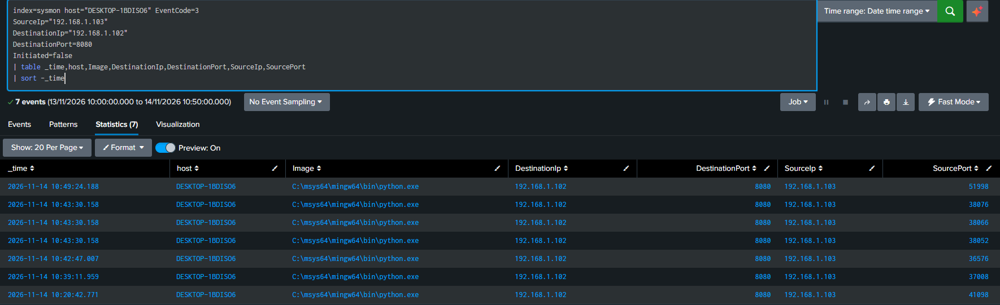
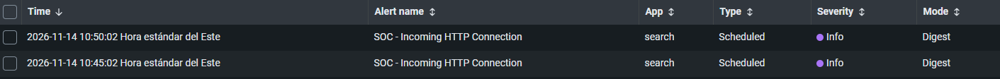

# DETECTION-001 — Incoming HTTP Connection

## 1. Detection Overview

| Field | Details |
|---|---|
| Detection ID | DETECTION-003 |
| Name | Incoming HTTP Connection |
| SIEM | Splunk Enterprise |
| Log Source | Sysmon |
| Event ID | 3 — Network Connection |
| Status | Validated |
| Severity | Informational |
| Environment | SOC Home Lab |

## 2. Lab Environment

The detection was tested using the following systems:

- **Attacker machine:** Kali Linux (`192.168.1.103`)
- **Target machine:** Fujitsu Windows (`192.168.1.102`)
- **Monitoring:** Sysmon and Splunk Universal Forwarder
- **SIEM:** Splunk Enterprise running on Dell Windows

A temporary Python HTTP server was configured on the Fujitsu machine, listening on TCP port 8080.

## 3. Detection Objective

Identify incoming TCP connections to the HTTP server running on the Fujitsu endpoint.

The objective was to verify that Sysmon could record incoming network connections and that Splunk could process the telemetry and generate an alert.

## 4. Detection Logic

The following SPL query was configured as a scheduled alert:

```spl
index=sysmon host="DESKTOP-1BDISO6" EventCode=3
SourceIp="192.168.1.103"
DestinationIp="192.168.1.102"
DestinationPort=8080
Initiated=false
```

The alert was configured to trigger when the search returned more than zero results.

## 5. Simulation and Testing

A controlled HTTP request was generated from Kali Linux:

```bash
curl http://192.168.1.102:8080/
```

The server returned the expected response:

```text
SOC-LAB - HTTP connection test
```

The incoming connection was recorded by Sysmon and forwarded to Splunk.

## 6. Observed Evidence

The investigation identified the following event:

| Field | Observed Value |
|---|---|
| Source IP | 192.168.1.103 |
| Source Port | 41098 |
| Destination IP | 192.168.1.102 |
| Destination Port | 8080 |
| Protocol | TCP |
| Process | python.exe |
| Process ID | 9312 |
| Initiated | false |

A second connection was also observed, associated with a different Python process ID (11096).

## 7. Alert Validation

The scheduled alert was tested under two conditions:

1. No new HTTP requests were generated: no repeated alert activation was observed.
2. A new HTTP request was generated from Kali: Splunk detected the new event and activated the alert.

## 8. Investigation and Classification

**Classification:** Benign Lab Activity.

The observed connections were intentionally generated as part of a controlled laboratory exercise.

The detection correctly identified the network activity. However, an incoming connection to TCP port 8080 is not inherently malicious.

Further investigation would be required in a real SOC environment to determine whether the source, destination, process and connection were authorized.

## 9. Lessons Learned

- Collecting network telemetry from endpoints using Sysmon.
- Identifying incoming connections using Event ID 3.
- Correlating source and destination IP addresses, ports and processes.
- Creating scheduled alerts in Splunk.
- Validating alert behavior through controlled simulations.
- Distinguishing detected activity from confirmed malicious behavior.

## 10. Evidence

### 1. SPL Detection Query



### 2. Triggered Alert


