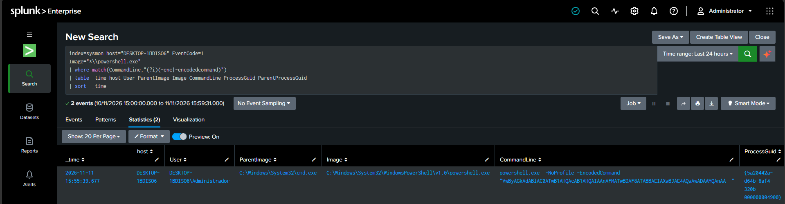

# INC-001 — Suspicious PowerShell Execution

## 1. Incident Overview

| Field | Details |
|---|---|
| Incident ID | INC-001 |
| Title | Suspicious PowerShell Execution |
| Date | November 11, 2026 |
| Affected Host | DESKTOP-1BDISO6 |
| User | DESKTOP-1BDISO6\Administrador |
| Detection Source | Splunk Enterprise |
| Data Source | Sysmon |
| Event ID | 1 — Process Creation |
| Severity | Low / Informational |
| Classification | Benign Lab Activity |
| Status | Closed |

## 2. Alert Summary

Splunk detected a PowerShell process launched with the `-EncodedCommand` argument.

This behavior can be associated with attempts to obfuscate PowerShell commands. However, encoded commands are not necessarily malicious and require further investigation.

The activity was generated intentionally as part of a controlled SOC home lab exercise.

## 3. Lab Environment

- **SIEM:** Splunk Enterprise
- **Endpoint monitoring:** Sysmon
- **Log collection:** Splunk Universal Forwarder
- **Attacker simulation environment:** Kali Linux
- **Monitored endpoint:** Windows Fujitsu laptop

Kali Linux was used to prepare the Base64-encoded test command. The command was executed locally on the Windows endpoint.

## 4. Detection Details

The detection rule searched for PowerShell process creation events containing encoded command arguments.

**Splunk SPL query:**

```spl
index=sysmon host="DESKTOP-1BDISO6" EventCode=1
Image="*\\powershell.exe"
| where match(CommandLine,"(?i)(-enc|-encodedcommand)")
| table _time host User ParentImage Image CommandLine ProcessGuid ParentProcessGuid
| sort -_time
```

**Observed event:**

| Field | Value |
|---|---|
| Timestamp | 2026-11-11 15:55:39.677 |
| Host | DESKTOP-1BDISO6 |
| User | DESKTOP-1BDISO6\Administrador |
| Parent Process | cmd.exe |
| Process | powershell.exe |
| Event ID | 1 |
| ProcessGuid | {5a20442a-d64b-6af4-320b-000000004900} |
| ParentProcessGuid | {5a20442a-d5d7-6af4-120b-000000004900} |

**Command line:**

```powershell
powershell.exe -NoProfile -EncodedCommand "VwByAGkAdABlAC0ATwB1AHQAcAB1AHQAIAAnAFMATwBDAF8ATABBAEIAXwBJAE4AQwAwADAAMQAnAA=="
```

## 5. Investigation Performed

The investigation focused on identifying the PowerShell execution context and understanding the encoded command.

The Base64 payload was decoded using Python in Kali Linux.

**Decoded command:**

```powershell
Write-Output 'SOC_LAB_INC001'
```

The command was designed to print a harmless test message and did not contain instructions to download files, modify system configurations or establish external connections.

The observed parent process was `cmd.exe`, which launched PowerShell.

## 6. Findings

The investigation established the following:

- Splunk successfully received the Sysmon process creation event.
- The PowerShell detection rule matched the `-EncodedCommand` argument.
- The process was executed under the local Administrator account.
- The parent process was `cmd.exe`.
- The decoded payload contained a harmless output command.
- The activity was intentionally generated for laboratory testing.

No evidence of malicious execution was identified in the supplied event.

Network activity and file creation were not independently validated as part of this investigation.

## 7. Classification and Decision

**Final classification: Benign Lab Activity.**

The detection successfully identified a behavior that can be suspicious in real environments. However, investigation of the encoded payload established that the command was harmless.

The alert was therefore classified as benign laboratory activity and closed.

## 8. Lessons Learned

This exercise demonstrated:

- Sysmon Event ID 1 process monitoring.
- Splunk alert detection using SPL.
- Identification of PowerShell encoded command execution.
- Base64 decoding using Python.
- Analysis of parent and child process relationships.
- The importance of validating command content before classifying an alert as malicious.

A detection rule identifying suspicious behavior does not automatically establish that a security incident has occurred.

## 9. Evidence

- Splunk search results showing the detected PowerShell execution.
- Encoded command extracted from the Sysmon event.
- Decoded command used in the controlled simulation.


