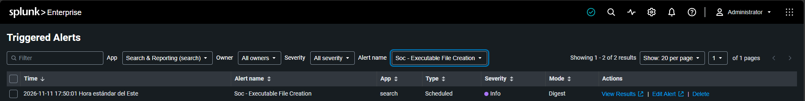
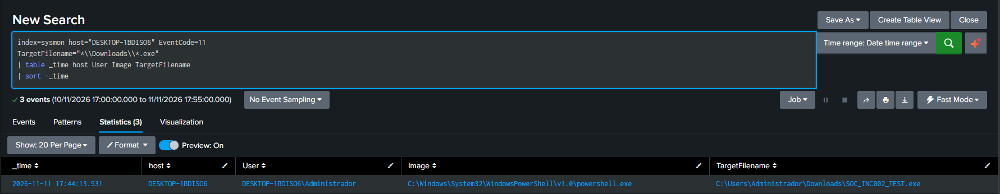
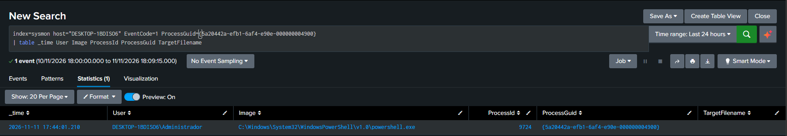

# INC-002 — Executable File Creation in Downloads

## 1. Incident Overview

| Field | Details |
|---|---|
| Incident ID | INC-002 |
| Title | Executable File Creation in Downloads |
| Date | November 11, 2026 |
| Affected Host | DESKTOP-1BDISO6 |
| User | DESKTOP-1BDISO6\Administrador |
| Detection Source | Splunk Enterprise |
| Data Source | Sysmon |
| Event ID | 11 — FileCreate |
| Severity | Low / Informational |
| Classification | Benign True Positive |
| Status | Closed |

## 2. Alert Summary

Splunk generated a scheduled alert after detecting the creation of an executable file inside the monitored endpoint's Downloads directory.

The detection rule identified a file with the `.exe` extension created under the following path:

`C:\Users\Administrador\Downloads\SOC_INC002_TEST.exe`

The activity was generated intentionally as part of a controlled SOC home lab exercise.

## 3. Lab Environment

- **SIEM:** Splunk Enterprise
- **Endpoint monitoring:** Sysmon
- **Log collection:** Splunk Universal Forwarder
- **Monitored endpoint:** Windows Fujitsu laptop
- **Investigation workstation:** Dell Windows 11 laptop

## 4. Detection Details

The scheduled Splunk detection searched for executable files created inside the Downloads directory.

**Splunk SPL query:**

```spl
index=sysmon host="DESKTOP-1BDISO6" EventCode=11
TargetFilename="*\\Downloads\\*.exe"
| table _time host User Image TargetFilename
| sort -_time
```

**Alert details:**

| Field | Value |
|---|---|
| Alert Name | Soc - Executable File Creation |
| Alert Type | Scheduled |
| Trigger Time | 2026-11-11 17:45:02 |
| Event Time | 2026-11-11 17:44:13.531 |
| Host | DESKTOP-1BDISO6 |
| User | DESKTOP-1BDISO6\Administrador |
| Creating Process | powershell.exe |
| Target File | SOC_INC002_TEST.exe |

## 5. Investigation Timeline

| Timestamp | Event |
|---|---|
| 17:44:01.210 | cmd.exe launched powershell.exe |
| 17:44:13.531 | powershell.exe created SOC_INC002_TEST.exe |
| 17:45:02 | Splunk generated the scheduled alert |

The timeline shows that the file creation occurred approximately 12 seconds after PowerShell started.

## 6. Process Investigation

Sysmon Event ID 1 was used to investigate the process responsible for the file creation.

**Observed process information:**

| Field | Value |
|---|---|
| Parent Process | cmd.exe |
| Parent Process ID | 5952 |
| Process | powershell.exe |
| Process ID | 9724 |
| Command Line | powershell |
| ProcessGuid | {5a20442a-efb1-6af4-e90e-000000004900} |
| ParentProcessGuid | {5a20442a-d5d7-6af4-120b-000000004900} |

The ProcessGuid from the process creation event matched the ProcessGuid recorded in the file creation event.

This correlation confirmed that the same PowerShell process identified in the investigation was responsible for creating the file.

## 7. File Analysis

The file was identified as:

`C:\Users\Administrador\Downloads\SOC_INC002_TEST.exe`

The file was created by copying the legitimate Windows Notepad executable:

`C:\Windows\System32\notepad.exe`

SHA256 hashes were calculated for both files.

**Analysis results:**

- The SHA256 hash of the copied file matched the original Notepad executable.
- The file was not executed during the investigation.
- No malicious behavior was identified in the checks performed.

The matching SHA256 hashes confirmed that both files contained identical data at the time of analysis.

## 8. Findings

The investigation established the following:

- Splunk successfully detected the creation of an executable file in Downloads.
- Sysmon recorded the file creation through Event ID 11.
- The file was created by powershell.exe.
- The PowerShell process was launched by cmd.exe.
- ProcessGuid correlation linked the process creation and file creation events.
- The copied executable had the same SHA256 hash as the original Windows Notepad executable.
- No subsequent execution of the copied file was observed in the available Sysmon process creation events.

## 9. Classification and Decision

**Final classification: Benign True Positive.**

The detection rule correctly identified an executable file created inside the Downloads directory.

However, investigation established that the file was an identical copy of the legitimate Windows Notepad executable and that no subsequent execution was observed.

The activity was intentionally generated as part of a controlled laboratory exercise.

The alert was classified as benign and closed.

## 10. Lessons Learned

This investigation demonstrated:

- Splunk scheduled alert configuration and validation.
- Sysmon Event ID 11 file creation monitoring.
- Sysmon Event ID 1 process investigation.
- Process correlation using ProcessGuid and ParentProcessGuid.
- SHA256 file integrity verification.
- Investigation of executable files created in user directories.
- Differentiation between a valid detection and malicious activity.

An executable file created in a user directory should be investigated, but its presence alone does not establish malicious activity.

## 11. Evidence

The following screenshots document the investigation:

### 1. Splunk Alert



### 2. Sysmon File Creation Event



### 3. Process Correlation



### 4. SHA256 Validation


